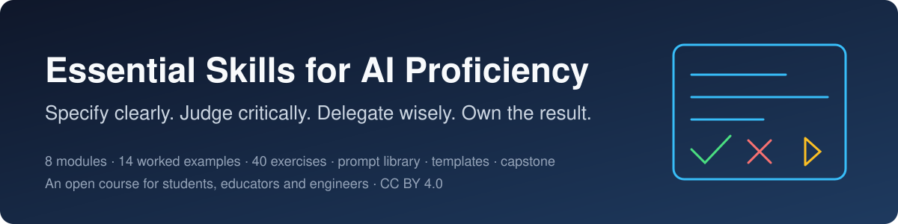
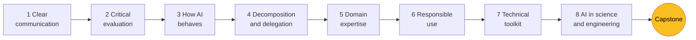

<div align="center">



[](CHANGELOG.md)
[](#course-map)
[](examples/worked-examples/README.md)
[](exercises/exercise-bank.md)
[](LICENSE.md)
[](LICENSE.md)
[](CONTRIBUTING.md)

**A practical, open course on the skills that matter most for working well with AI.**
For students, educators and professionals; no technical background needed for the first six modules.

</div>

> **Core idea:** AI proficiency is less about which tools you know and more about how you work with AI. Tools change every year. The ability to specify clearly, delegate wisely, and judge critically does not.

## Start here

| You are… | Begin with | Then |
|----------|-----------|------|
| **A student** who wants to use AI well and keep learning | [Module 1](modules/01-clear-communication.md) and [worked example 1](examples/worked-examples/01-prompt-makeover.md) (20 minutes) | the modules in order, one worked example and one [exercise](exercises/exercise-bank.md) each; keep notes with the [templates](templates/README.md) |
| **An engineering or science student** with problem sets, labs and code | [Module 8](modules/08-ai-for-study-and-research.md) and [worked example 5](examples/worked-examples/05-checking-a-derivation.md) | the [engineering prompts](examples/prompts/engineering.md); exercises 8.1-8.3 on your own coursework |
| **An instructor** planning a course | the [Teaching Guide](TEACHING-GUIDE.md) (8- and 12-week schedules, grading, integrity) | the [exercise bank](exercises/exercise-bank.md) with [instructor notes](exercises/instructor-notes.md); the [capstone](capstone/README.md) |
| **Anyone** with ten minutes | the [FAQ](faq.md) | one worked example from the list below |

## What you will be able to do

- Write a prompt as a **specification** that a capable stranger could not misread, and know which guess you removed.
- **Verify** AI output by means the AI did not control: a source, a test, a hand calculation, a limiting case.
- Predict **where AI fails** - arithmetic, references, edge cases, recent events, anything it cannot see - and choose tasks and tools accordingly.
- **Delegate** to AI agents with a brief that has an outcome, context and a check, and keep the decisions that are yours.
- Use AI as a **tutor** so that your own expertise grows instead of eroding.
- Share data and grant permissions **responsibly**, recognise prompt injection, and **disclose** AI use credibly.
- Read, test and judge AI-written **code**; profile data before analysing it; check every reference before citing it.

## Course map

| # | Module | Focus | Technical? |
|---|--------|-------|------------|
| 1 | [Clear communication](modules/01-clear-communication.md) | Prompting as precise specification | No |
| 2 | [Critical evaluation](modules/02-critical-evaluation.md) | Judging whether AI output is correct and good | No |
| 3 | [How AI behaves](modules/03-how-ai-behaves.md) | A practical mental model of strengths and limits | No |
| 4 | [Decomposition and delegation](modules/04-decomposition-and-delegation.md) | Breaking work into tasks AI can carry out | No |
| 5 | [Domain expertise](modules/05-domain-expertise.md) | Why knowing your field makes AI more useful | No |
| 6 | [Responsible use](modules/06-responsible-use.md) | Privacy, security, and accountability | No |
| 7 | [The technical toolkit](modules/07-technical-toolkit/README.md) | Python, command line, Git, Markdown, SQL, APIs, LaTeX | Yes |
| 8 | [AI in science and engineering work](modules/08-ai-for-study-and-research.md) | Derivations, calculations, code, data, literature - and the check that catches AI's mistake in each | Partly |
| ★ | [Capstone project](capstone/README.md) | Bring everything together in one real project, with a documented process | Mixed |

Every module has learning goals, key ideas, practice with a real AI assistant, common mistakes, reflection questions, a linked worked example, exercises and a [self-check quiz](exercises/self-check-quizzes.md).



## Learn from mistakes that look like right answers

The fourteen [worked examples](examples/worked-examples/README.md) show real-looking AI output with its errors left in, and the routine that found each one. A sample:

| The AI said… | What was wrong | How it was caught |
|--------------|----------------|-------------------|
| "I have attached the conference programme" in a drafted email | there was no attachment | reading every sentence as if signing it — [example 1](examples/worked-examples/01-prompt-makeover.md) |
| Three references with DOIs | one DOI was invented; a real paper's claim was stated backwards | `check_citations.py`, then reading the paper — [example 2](examples/worked-examples/02-fact-checking-a-summary.md) |
| A function that "handles missing values" | passed the example, failed five of six real inputs | a test table written before asking — [example 3](examples/worked-examples/03-debugging-ai-code.md) |
| "The gas cools on adiabatic compression" with a six-step proof | a dropped sign in step 4 | a bicycle pump (limiting case) — [example 5](examples/worked-examples/05-checking-a-derivation.md) |
| "The difference is not significant (p = 0.37)" | wrong test for a paired design; the real p was 0.0001 | asking what the data's structure was — [example 10](examples/worked-examples/10-choosing-a-statistical-test.md) |
| "All 8 tests now pass" from a coding agent | it had edited the tests, not the code | reading the diff — [example 11](examples/worked-examples/11-supervising-a-coding-agent.md) |
| A 30-term English-Russian-Kazakh glossary | six everyday meanings of technical words (head, draft, fitting) | back-translation and the textbook — [example 13](examples/worked-examples/13-bilingual-glossary.md) |

## Everything in the repository

| | What you get |
|---|---|
| **Modules** | Eight modules, each 20-40 minutes of reading plus practice |
| **[Worked examples](examples/worked-examples/README.md)** | Fourteen annotated case studies, from a prompt makeover to supervising a coding agent |
| **[Prompt library](examples/prompts/README.md)** | Annotated prompts for studying, writing, coding, data analysis, literature and engineering problems |
| **[Exercises](exercises/README.md)** | Forty graded exercises with deliverables and marking points, self-check quizzes for every module, instructor notes |
| **[Templates](templates/README.md)** | PROCESS.md, AI disclosure statement, prompt log, verification log, delegation brief |
| **[Scripts and data](examples/README.md)** | A CSV profiler, a DOI checker, a test template for AI-written code, a variability measurement, a quiz generator; a lab dataset with the faults real data have |
| **[Capstone](capstone/README.md)** | The brief and rubric, thirty project ideas by field, and a complete sample process record |
| **[Glossary](glossary.md) · [FAQ](faq.md) · [Resources](resources.md)** | Plain-language definitions, first-week questions, curated links |
| **[Teaching Guide](TEACHING-GUIDE.md)** | 8- and 12-week schedules, grading that rewards process, academic integrity in an AI-permitted course |

## How to use this course

**Students:** work through the modules in order. Read the linked worked example before the practice, do the practice with a real AI assistant, check yourself with the quiz, and keep your notes in Markdown using the templates. If you are in a technical degree, take module 8 alongside your current courses: its exercises use your own problem sets and lab data.

**Instructors:** see the [Teaching Guide](TEACHING-GUIDE.md). Ask students to fork this repository so each has a copy to commit to; the exercise deliverables and templates are designed to live there. Three of the scripts need no AI account at all and work in a lab with no setup beyond Python.

**Everyone:** the material is CC BY 4.0. Adapt it, translate it ([CONTRIBUTING.md](CONTRIBUTING.md) explains the translations folder), and send back what worked.

## Suggested learning path

1. Start with **clear communication** and **Markdown**. Both pay off immediately and need no setup.
2. Work through modules **2 to 6** to build judgment and good habits.
3. Learn **Python** and the **command line** together, then add **Git and GitHub**.
4. Add **SQL**, **APIs**, and **data formats** when you start building projects.
5. Learn **LaTeX or Typst** only if your field calls for it.
6. If you are in a technical degree, work through **module 8** alongside your current courses.
7. Finish with the **capstone project**.

## Repository structure

```
essential-ai-skills-2026/
├── README.md                  ← you are here
├── TEACHING-GUIDE.md          ← for instructors: schedules, grading, integrity
├── glossary.md · faq.md       ← definitions; first-week questions
├── resources.md               ← curated links
├── modules/                   ← the six core skills, the toolkit, AI in technical work
│   └── 07-technical-toolkit/  ← one guide per tool
├── examples/
│   ├── worked-examples/       ← fourteen annotated case studies
│   ├── prompts/               ← the prompt library
│   ├── python/                ← scripts (profiler, DOI checker, test template, ...)
│   ├── data/                  ← a lab dataset with realistic faults
│   └── sql/                   ← the practice database
├── exercises/                 ← exercise bank, self-check quizzes, instructor notes
├── templates/                 ← PROCESS.md, disclosure, logs, delegation brief
└── capstone/                  ← brief, rubric, thirty ideas, a sample process record
```

## Contributing

Corrections, new exercises, worked examples from your own experience, and translations are welcome. See [CONTRIBUTING.md](CONTRIBUTING.md). Finding that an example is out of date — because current tools no longer make that mistake, or make a different one — is itself the course's skill in action, and a good pull request.

## Version

Version 1.1, October 2026 (see [CHANGELOG.md](CHANGELOG.md)). AI tools change quickly; see the [Teaching Guide](TEACHING-GUIDE.md) for how to keep the course current.

## Author

**Yanwei Wang** · [GitHub @ktwyw](https://github.com/ktwyw) · [ORCID 0000-0002-8488-9833](https://orcid.org/0000-0002-8488-9833)

## License

Course text is shared under [CC BY 4.0](LICENSE.md); example code under the MIT License. You may reuse and adapt it with attribution.
